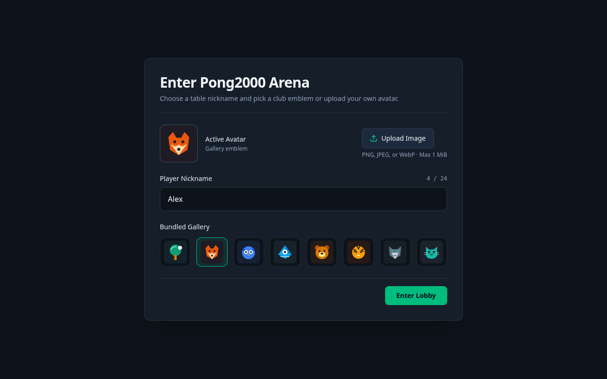
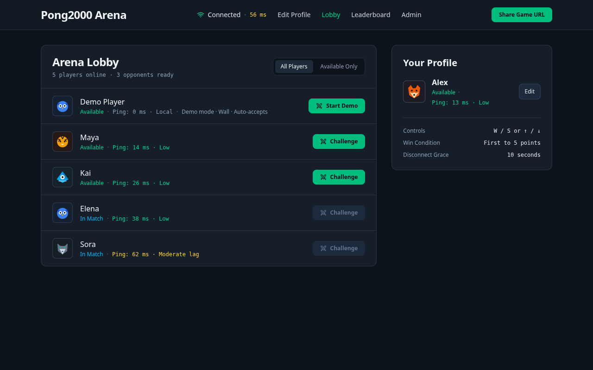
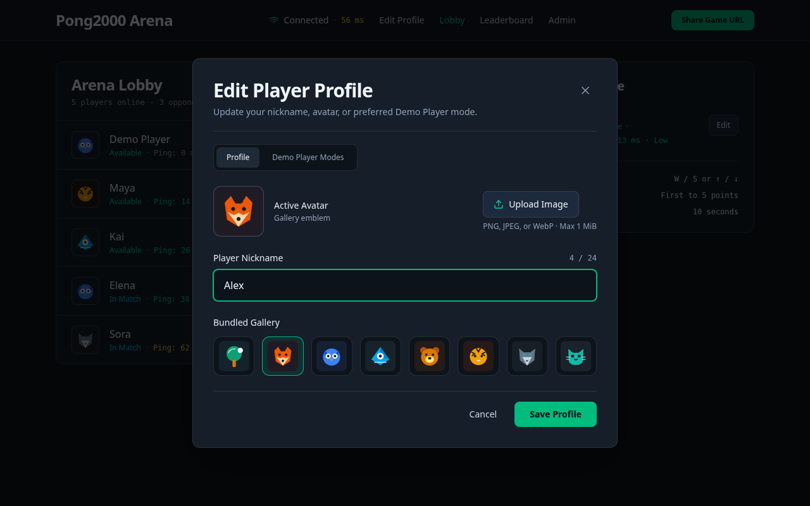
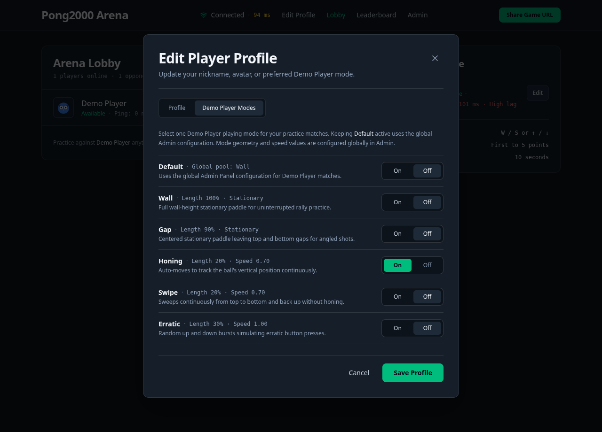
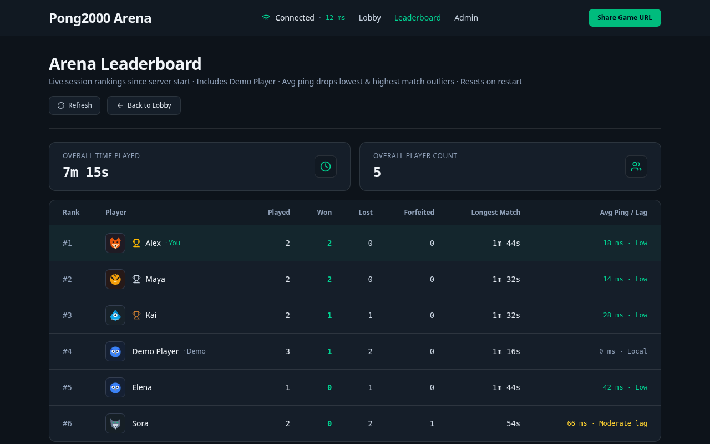
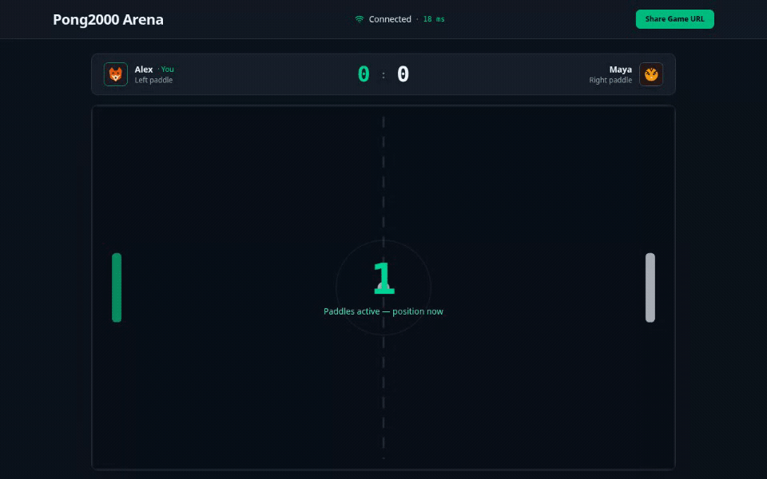
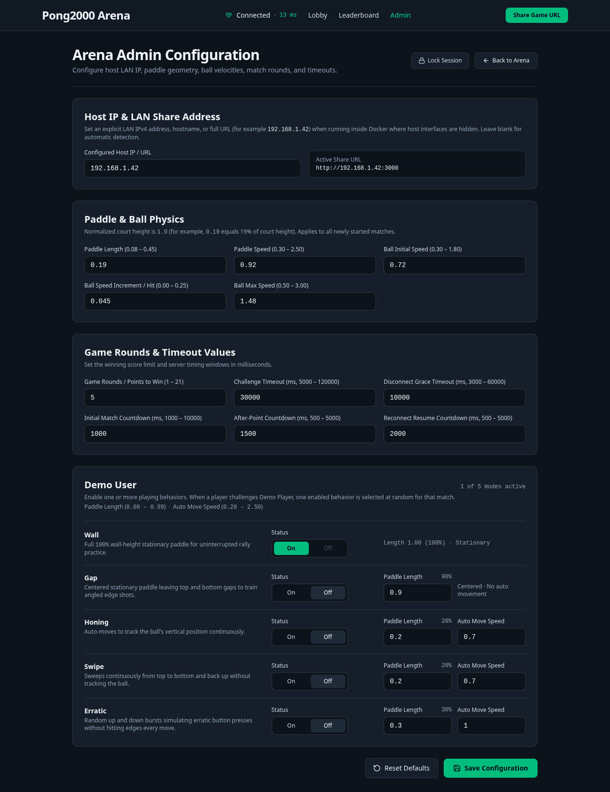

# Pong2000 Arena

Self-hosted, browser-native two-player Pong arena for a local area network (LAN). Players open the host URL in a desktop browser, pick a nickname and avatar (bundled gallery or uploaded PNG/JPEG/WebP), discover players in a live lobby, exchange challenges, and play server-authoritative 60 Hz matches with automatic reconnect recovery.

## Screenshots

### Commercial Video

Check out the following videos to show the experience of Pong2000!

- [Video 01](file:docs/videos/01/pong2000-commercial.mp4)
- [Video 02](file:docs/videos/02/pong2000-commercial.mp4)

### Initial Profile Creation



### Arena Lobby



### Edit Player Profile

**Profile Tab**



**Demo Player Modes Tab**



Players can select their prefered game mode with the Demo Player.
If default is selected, the server side settings take effect.

### Arena Leaderboard



### Live Two-Player Match



### Admin Console



## Quick Start (Docker Compose)

1. Copy `.env.example` to `.env` if you want to customize settings (optional):
   ```bash
   cp .env.example .env
   ```
2. Build and start the container:
   ```bash
   docker compose up -d --build
   ```
3. Verify health:
   ```bash
   curl http://127.0.0.1:3000/healthz
   ```
4. Share the host LAN URL (`http://<LAN_HOST_IP>:3000`) with players. You can also click **Share Game URL** in the app header to view detected LAN IPv4 addresses and an offline QR code.

Uploaded avatars are stored as sanitized 256x256 WebP images inside the `avatars_data` Docker volume (`/data/avatars`) and persist across container restarts. Active matches and lobby sessions stay in memory and reset cleanly on container restart.

## Offline / Air-Gapped LAN Preparation

Build and export the image while connected to the internet, then load it on an isolated LAN host:

```bash
# On a machine with Docker and internet access
docker build -f app.Dockerfile -t pong2000-arena:latest .
docker save -o pong2000-arena.tar pong2000-arena:latest

# On the offline LAN host
docker load -i pong2000-arena.tar
docker compose up -d --no-build
```

No external CDNs, hosted fonts, or cloud APIs are used at runtime.

## Local Development & Tests

```bash
npm install --legacy-peer-deps
npm run dev      # Starts Express + WebSocket + Vite dev middleware on port 3000
npm test         # Runs Vitest unit and WebSocket protocol integration tests
npm run lint     # TypeScript typecheck
npm run build    # Builds production client bundle into dist/
npm start        # Runs production server via Node.js (requires npm run build first)
```

## Controls, Demo Mode & Match Rules

- **Move Paddle:** `W` / `S` or `ArrowUp` / `ArrowDown`
- **Demo Mode (`Demo Player`):** Challenge **Demo Player** in the Lobby at any time to auto-start a practice match. Initial player profiles start with the **Default** preference (using the global Admin Panel mode pool). After creating a profile, players can open **Edit Profile → Demo Player Modes** to toggle a single active mode (`Default`, `Wall`, `Gap`, `Honing`, `Swipe`, or `Erratic`) for their own Demo Player matches without altering global mode settings.
- **Countdown Head Start:** Paddles unlock during the final 1 second of the pre-serve countdown (from second 2 onward on match start) so players can position before the ball moves.
- **Win Condition & Timeouts:** Default first to 5 points wins, 30s challenge expiry, and 10s disconnect grace (all configurable at runtime in `/admin`).
- **Live Server Ping:** Real-time WebSocket round-trip latency (`ms`) appears on every player's Arena Lobby listing, in the Top Bar, and in the Match HUD to spot network lag immediately.

## Leaderboard (`/leaderboard`)

Visit `/leaderboard` (or click **Leaderboard** in the top navigation bar, or query `GET /api/leaderboard`) to view live runtime session totals (**Overall Time Played** and **Overall Player Count**) alongside live player rankings since the server started, including **Demo Player**. Top three players display Gold, Silver, and Bronze trophy icons alongside total matches played, won, lost, forfeited, longest match duration, and overall match-averaged ping / lag (collected from each match's lowest and highest ping values with the overall lowest and highest outliers removed). Session stats reset on server restart.

## Admin Console (`/admin`)

Visit `/admin` (or click **Admin** in the top navigation bar) to configure runtime server settings without restarting the container:

- **Host IP / URL:** Explicitly set the LAN IPv4 address or URL shown in **Share Game URL** (recommended when running inside Docker on bridge networking).
- **Gameplay Physics & Rules:** Tune paddle length (`0.08–0.45`), paddle speed (`0.30–2.50`), ball initial/increment/max speeds, and points to win (`1–21`).
- **Timeouts:** Adjust challenge expiry, disconnect grace period, and initial/after-point/reconnect countdown durations.
- **Demo User:** Toggle and tune each global Demo Player playing mode (`Wall`, `Gap`, `Honing`, `Swipe`, `Erratic`). At least one global mode stays active; players set to **Default** randomly receive one globally enabled mode, while players who select a specific mode in **Edit Profile → Demo Player Modes** play that mode with the Admin-configured parameters.

Set `ADMIN_PASSCODE` in `.env` to lock `/admin` with a predefined passcode, or leave it unset to claim a one-time passcode on your first visit to `/admin`.

## Troubleshooting

- **Other devices cannot reach the page:**
  - Confirm the host's LAN IPv4 address (`ip addr`, `ifconfig`, or `ipconfig`) and share `http://<LAN_HOST_IP>:3000`, not `localhost` or `127.0.0.1`.
  - Allow inbound TCP port `3000` on the host firewall (e.g., `sudo ufw allow 3000/tcp`).
- **Devices on the same Wi-Fi cannot connect to each other:**
  - Public, conference, or guest Wi-Fi networks often enable **AP/client isolation**, blocking peer-to-host LAN traffic. Use a private router, travel AP, or mobile hotspot.
- **WebSocket connection fails through a reverse proxy:**
  - Ensure your proxy forwards `Upgrade` and `Connection: upgrade` headers for `/ws`, and add the proxy origin to `ALLOWED_ORIGINS` if `Origin` differs from `Host`.
- **Trust Note (LAN MVP):**
  - Traffic on a plain HTTP LAN (`http://` / `ws://`) is unencrypted; run behind a trusted local network or terminate TLS in front if deploying on untrusted networks.

## License

This project is licensed under the [MIT License](LICENSE).
