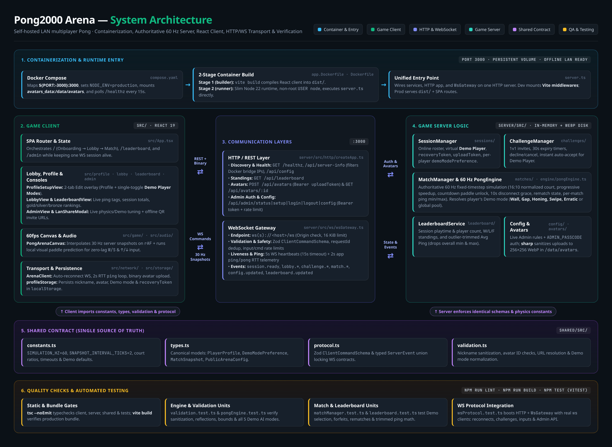
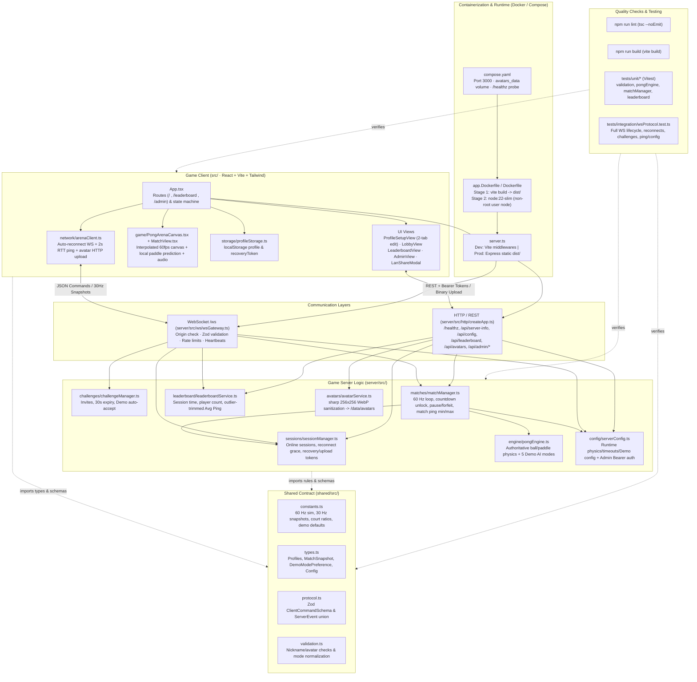

# Pong2000 Arena — Architecture & Design



---

## 1. Architectural Overview & Correlation



### Project Layout

```text
.
├── server.ts                  # Unified HTTP + WS + SPA entry point (dev & prod)
├── shared/src/                # Single source of truth imported by BOTH client & server
│   ├── constants.ts           # Physics tuning, 60Hz/30Hz timing, Demo defaults, bundled avatars
│   ├── types.ts               # Shared TypeScript domain interfaces
│   ├── protocol.ts            # Zod schemas for WS commands + discriminated ServerEvent types
│   └── validation.ts          # Shared sanitization & avatar/demo-mode normalization
├── server/src/                # Authoritative game server & REST API services
│   ├── http/createApp.ts      # Express REST API, avatar upload/download, LAN IP resolution
│   ├── ws/wsGateway.ts        # WebSocket /ws router, heartbeats, rate limits, state broadcasts
│   ├── sessions/              # Player identity, upload/recovery tokens, disconnect grace
│   ├── challenges/            # 1v1 challenge lifecycle & Demo Player auto-accept
│   ├── matches/               # Active match state machines, timers, 60 Hz simulation ticks
│   ├── engine/                # Pure deterministic Pong physics & Demo AI behaviors
│   ├── leaderboard/           # In-memory standings, session play totals, outlier-trimmed ping
│   ├── config/                # Runtime Admin configuration + passcode/token auth
│   └── avatars/               # Image validation & sharp WebP conversion to disk
├── src/                       # Browser SPA (React 19 + Tailwind CSS v4)
│   ├── App.tsx                # Top-level state machine, navigation, WS/REST coordination
│   ├── network/arenaClient.ts # Reconnecting WebSocket client + ping RTT measurement
│   ├── game/                  # Canvas renderer (interpolation + prediction) & Match HUD
│   ├── profile/               # Onboarding + 2-tab Edit Profile (Profile & Demo Player Modes)
│   ├── lobby/                 # Live player list, status/ping indicators, challenge actions
│   ├── leaderboard/           # Session totals, ranked table, trophies, trimmed Avg Ping
│   ├── admin/                 # Passcode login + runtime physics/timeouts/Demo mode controls
│   ├── components/            # AvatarImg & LanShareModal (offline LAN QR generator)
│   ├── audio/                 # WebAudio sound effects
│   └── storage/               # localStorage persistence for profile & recoveryToken
├── public/avatars/            # Bundled SVG club emblems (rally-fox, smash-tiger, etc.)
├── tests/                     # Vitest unit & integration test suites
├── docs/                      # Project definition, architecture, screenshots, and commercial videos
├── compose.yaml               # Docker Compose service, port 3000, persistent volume
└── app.Dockerfile / Dockerfile# Two-stage production container image
```

**Core correlation principle:** `shared/src/` sits at the center so the React client and Node server never drift on physics constants (`ARENA_ASPECT`, `PADDLE_WIDTH`, `SIMULATION_HZ`), validation bounds, or WebSocket wire schemas (`ClientCommandSchema`, `ServerEvent`).

---

## 2. Containerization (`Dockerfile`, `app.Dockerfile`, `compose.yaml`)

- **Two-Stage Build (`app.Dockerfile` & `Dockerfile`):**
  1. **Builder stage (`node:22-slim`):** Installs full dependencies (including Vite, TypeScript, and Tailwind) and runs `npm run build` to compile `src/` and `shared/` into static assets in `dist/`.
  2. **Runner stage (`node:22-slim`):** Installs production-only dependencies (`--omit=dev`), copies `dist/`, `server.ts`, `server/`, `shared/`, and `public/`. Executes TypeScript natively on Node 22 via `node --experimental-strip-types server.ts`, eliminating a separate backend build step.
- **Security & Persistence (`compose.yaml`):**
  - Runs as unprivileged user `node` (`USER node`).
  - Persists uploaded `256×256` WebP avatars across container restarts via the named Docker volume `avatars_data:/data/avatars`.
  - Configures a container `HEALTHCHECK` polling `GET /healthz` every 15s.
- **Container-Aware LAN Discovery (`createApp.ts`):**
  - Checks `fs.existsSync('/.dockerenv')` to detect container execution and filters out internal Docker `172.16.0.0/12` bridge IPs from `getLanUrls()`, prioritizing `PUBLIC_URL`, an Admin-configured Host IP, or host LAN IPv4 addresses for **Share Game URL** and QR codes.
- **Dev vs. Prod Dual Runtime (`server.ts`):**
  - In development (`NODE_ENV !== 'production'`), `server.ts` mounts `vite.middlewares` inside Express so frontend HMR/bundling and the `/ws` backend share port `3000`.
  - In production (`NODE_ENV=production`), Express serves static files from `dist/` with an SPA fallback for `/`, `/leaderboard`, and `/admin`.

---

## 3. Game Server Logic (`server/src/*`)

All gameplay, lobby, and ranking state is **server-authoritative** and held in memory (aside from uploaded avatars persisted on disk):

1. **Sessions (`sessions/sessionManager.ts`):**
   - Tracks connected human players alongside the built-in virtual **`Demo Player`** (`bot_demo_player`).
   - Issues a `recoveryToken` (enabling seamless browser reload or network drop recovery during `disconnectGraceMs`) and an `uploadToken` (authorizing `POST /api/avatars`).
   - Stores each player's `demoModePreference` (`default`, `wall`, `gap`, `honing`, `swipe`, `erratic`).
2. **Challenges (`challenges/challengeManager.ts`):**
   - Manages lobby invites with automatic expiry (default 30s), declines, and cancellations.
   - Immediately auto-accepts challenges targeting `Demo Player` without requiring an opponent socket.
3. **Matches & Physics (`matches/matchManager.ts` + `engine/pongEngine.ts`):**
   - `pongEngine.ts` implements pure, side-effect-free 2D Pong physics in normalized `[0, 1]` coordinates (`16:10` aspect ratio): paddle bounds clamping, angle bounces up to `50°`, progressive ball speedup per volley, and 5 Demo AI modes (`Wall`, `Gap`, `Honing`, `Swipe`, `Erratic`).
   - `matchManager.ts` runs an independent **60 Hz fixed-timestep simulation loop** per active match, broadcasts **`match.snapshot` at 30 Hz** (`SNAPSHOT_INTERVAL_TICKS = 2`), handles pre-serve countdowns (unlocking paddles during the final 1s), tracks per-match lowest and highest player ping, pauses on mid-match disconnect, and manages rematch state.
   - When a match starts against `Demo Player`, it loads the player's `demoModePreference` (falling back to a random globally enabled Admin mode when set to `default`).
4. **Leaderboard (`leaderboard/leaderboardService.ts`):**
   - Tracks per-player standings (`played`, `won`, `lost`, `forfeited`, `longestMatchMs`) and live session totals (**Overall Time Played**, **Overall Player Count**).
   - Computes each player's **Avg Ping / Lag** across matches by storing the lowest and highest ping per match and dropping the overall lowest and highest outlier samples before averaging.
5. **Runtime Config & Admin Auth (`config/serverConfig.ts`):**
   - Holds live-tunable physics, timeouts, LAN Host IP override, and global Demo Player mode settings.
   - Supports `ADMIN_PASSCODE` from environment variables or a one-time setup flow via `/api/admin/setup`, issuing Bearer session tokens verified by `requireAdmin`.
6. **Avatars (`avatars/avatarService.ts`):**
   - Validates image uploads (PNG/JPEG/WebP, max 1 MiB) and converts them with `sharp` into sanitized `256×256` WebP images stored by UUID key.

---

## 4. Game Client (`src/*`)

A browser-native React 19 + TypeScript single-page application styled with Tailwind CSS v4:

- **Routing & State (`App.tsx`):** Coordinates views across `/`, `/leaderboard`, and `/admin` via `window.history.pushState` while maintaining a single persistent `ArenaClient` WebSocket connection across route transitions.
- **Profile & Preferences (`profile/ProfileSetupView.tsx`, `storage/profileStorage.ts`):**
  - Renders initial nickname/avatar onboarding and the **Edit Player Profile** overlay with two tabs: **Profile** (nickname, gallery, upload) and **Demo Player Modes** (single-toggle preference selection).
  - Persists profile data and `recoveryToken` in `localStorage`.
- **Arena Lobby (`lobby/LobbyView.tsx`):** Displays online players, `Available` / `In Match` states, real-time `Ping: X ms` readouts, filters (`All Players` / `Available Only`), and challenge controls.
- **Client Game Rendering (`game/PongArenaCanvas.tsx` & `game/MatchView.tsx`):**
  - Captures keyboard inputs (`W`/`S` and `ArrowUp`/`ArrowDown`) and sends `match.input` commands only when movement direction changes.
  - Interpolates smoothly between the two latest 30 Hz `match.snapshot` updates in `requestAnimationFrame` while applying **visual-only local paddle prediction** so controls feel instantaneous.
  - Triggers WebAudio sound effects (`src/audio/`) for paddle hits, scoring, countdowns, and match completion.
- **Leaderboard, Admin & Share Modal (`leaderboard/LeaderboardView.tsx`, `admin/AdminView.tsx`, `components/LanShareModal.tsx`):**
  - Displays live `leaderboard.updated` pushes, provides the passcode-protected `/admin` configuration panel, and renders offline LAN QR codes via `qrcode`.

---

## 5. Communication Layers

Pong2000 separates control/media queries from low-latency gameplay over **two transport channels** hosted on the same port (`3000`):

### A. HTTP / REST (`server/src/http/createApp.ts`)
- **Health & Network Discovery:** `GET /healthz`, `GET /api/server-info` (LAN URLs + container detection), `GET /api/config`
- **Leaderboard Snapshot:** `GET /api/leaderboard`
- **Avatars:** `POST /api/avatars` (raw binary + `Bearer uploadToken`), `GET /api/avatars/:id` (immutable cached WebP)
- **Admin Console:** `GET /api/admin/status`, `POST /api/admin/setup`, `POST /api/admin/login` (IP rate-limited), `POST /api/admin/logout`, `GET|PUT /api/admin/config`, `POST /api/admin/config/reset`

### B. Bidirectional WebSocket `/ws` (`server/src/ws/wsGateway.ts` ↔ `src/network/arenaClient.ts`)
- **Security & Input Validation:** Verifies request `Origin`, caps frame payloads at `16 KiB`, validates every command with Zod (`ClientCommandSchema`), deduplicates `requestId`s, and enforces per-socket rate limits (`commandTimestamps`, `inputTimestamps`).
- **Connection & Latency Lifecycle:**
  - Client sends `session.hello` (with optional `recoveryToken`) → server responds with `session.ready` containing lobby state, active challenge/match sync, and `arenaConfig`.
  - **Application RTT Ping:** Client sends `ping` every `2s` (reporting `lastPingMs` so the server updates lobby displays and match min/max ping telemetry) → server responds with `pong`.
  - **Transport Heartbeat:** Server issues WebSocket protocol pings every `5s` with a `15s` timeout (`HEARTBEAT_INTERVAL_MS` / `HEARTBEAT_TIMEOUT_MS`).
  - **Auto-Reconnect:** `ArenaClient` reconnects with exponential backoff and resumes active matches within `disconnectGraceMs`.
- **Real-Time Server Pushes (`ServerEvent`):** `lobby.*`, `challenge.*`, `match.started`, `match.snapshot` (30 Hz), `match.phase`, `match.finished`, `match.rematch.updated`, `config.updated`, and `leaderboard.updated`.

---

## 6. Quality Checks & Testing

| Layer | Command / File | What It Verifies |
| :--- | :--- | :--- |
| **Static Typecheck** | `npm run lint` (`tsc --noEmit`) | Type safety across `src/`, `server/`, `shared/`, and `tests/`. |
| **Production Build** | `npm run build` (`vite build`) | Bundles React/Tailwind client into `dist/` and catches asset/bundling errors. |
| **Unit: Validation** | `tests/unit/validation.test.ts` | Nickname sanitization, avatar ID validation, and `demoModePreference` normalization. |
| **Unit: Physics & AI** | `tests/unit/pongEngine.test.ts` | Ball reflections, paddle collisions, serve resets, speedup caps, and all 5 Demo AI behaviors (`Wall`, `Gap`, `Honing`, `Swipe`, `Erratic`). |
| **Unit: Match State** | `tests/unit/matchManager.test.ts` | Match creation, Demo mode resolution (`default` vs explicit preference), countdown paddle unlock, pause/forfeit timers, and rematch logic. |
| **Unit: Leaderboard** | `tests/unit/leaderboard.test.ts` | Ranking sort order, session total playtime/player count, and lowest/highest outlier ping trimming. |
| **Integration: WS Protocol** | `tests/integration/wsProtocol.test.ts` | Boots an ephemeral HTTP + `WsGateway` server and drives real `ws` clients through `session.hello`, profile updates, challenges, live match inputs, disconnect recovery, ping aggregation, and runtime `/api/admin/config` updates. |

All unit and integration suites execute together via **`npm test`** (`vitest run`).
