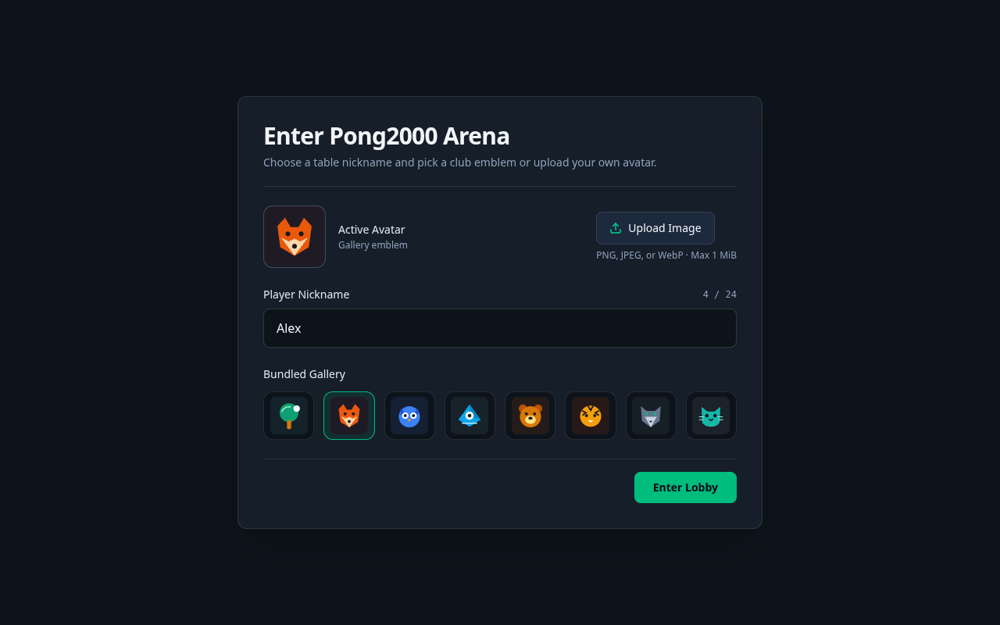
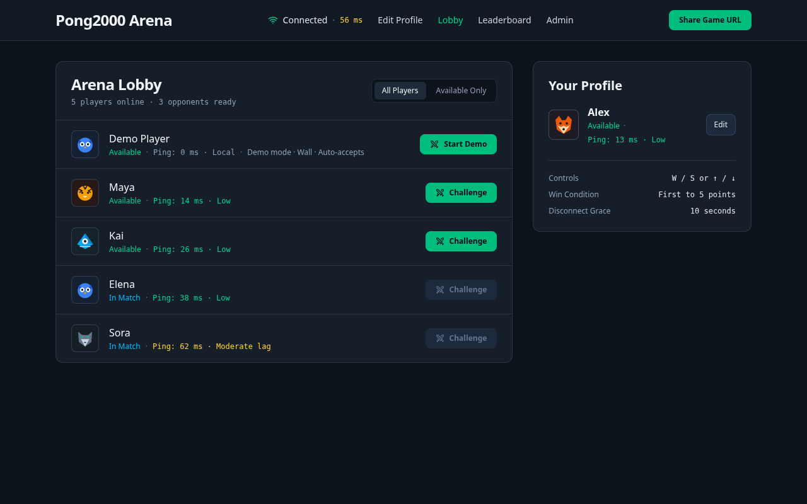
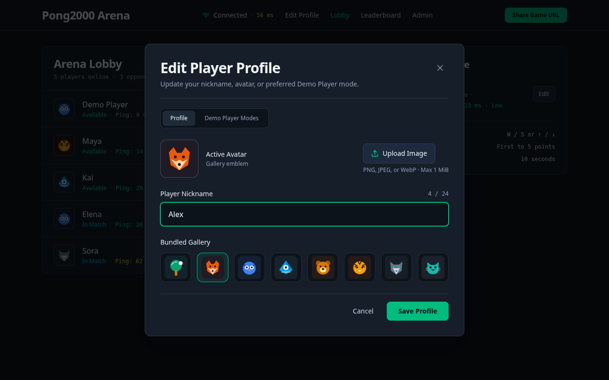
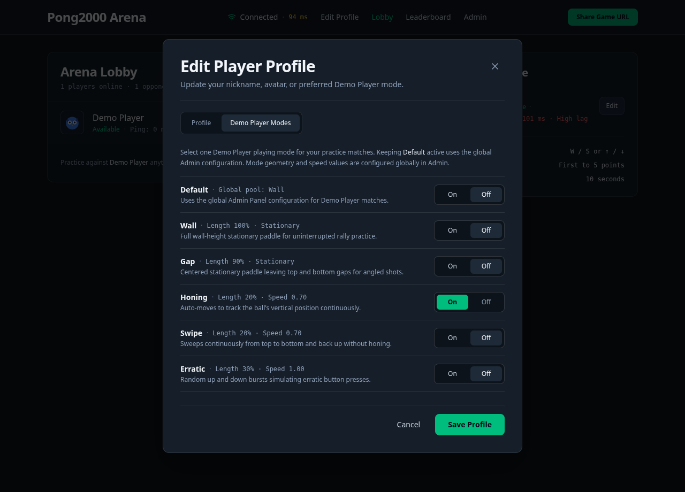
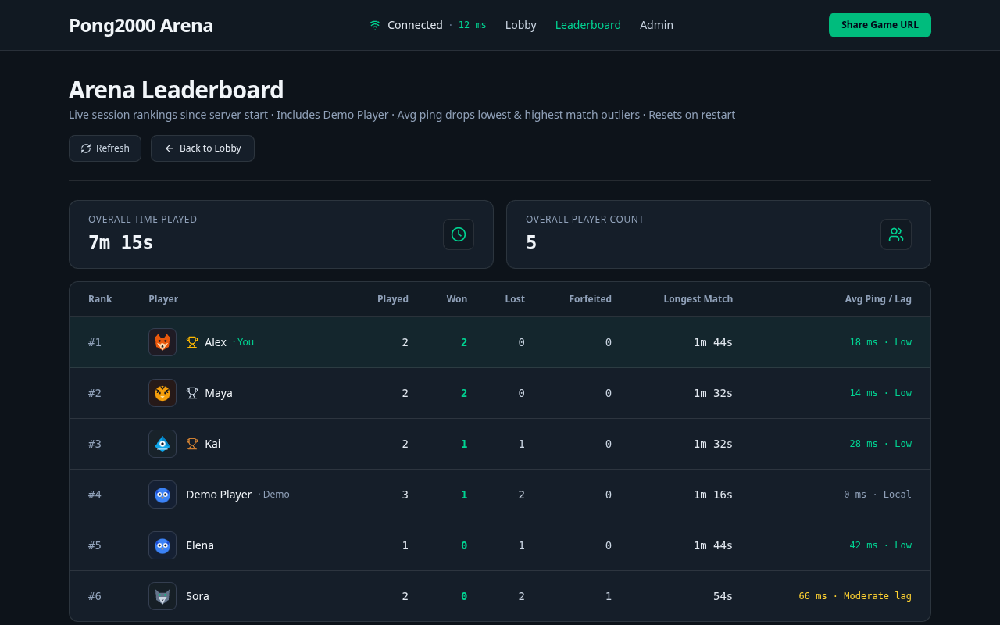
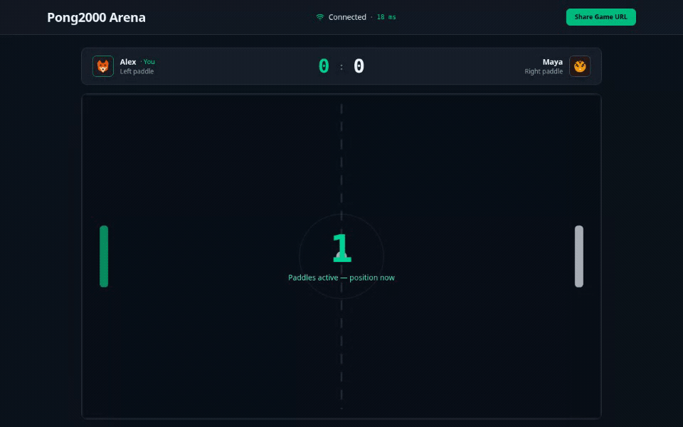
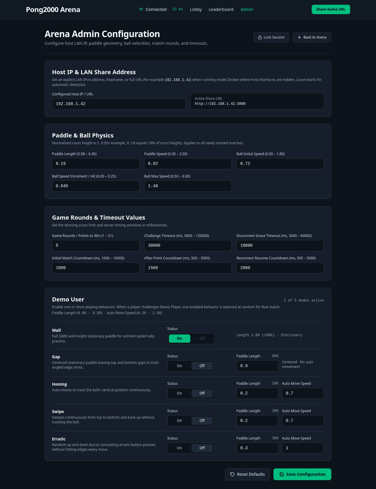

# Pong2000 Arena (Networked Multiplayer)

Self-hosted, browser-native two-player Pong arena for a local area network (LAN). Players open the host URL in a desktop browser, pick a nickname and avatar (bundled gallery or uploaded PNG/JPEG/WebP), discover players in a live lobby, exchange challenges, and play server-authoritative 60 Hz matches with automatic reconnect recovery.

---

## Documentation & Media

- **Build, Docker & Deployment:** [`docs/build/README.md`](docs/build/README.md)
- **System Architecture & Design:** [`docs/architecture/design.md`](docs/architecture/design.md)
- **Full Product Specification:** [`../../docs/PROJECT_DEFINITION.md`](../../docs/PROJECT_DEFINITION.md)
- **Commercial Videos:**
  - [Video 01](../../docs/videos/01/pong2000-commercial.mp4)
  - [Video 02](../../docs/videos/02/pong2000-commercial.mp4)

---

## Screenshots

### Initial Profile Creation


### Arena Lobby


### Edit Player Profile

**Profile Tab**



**Demo Player Modes Tab**



Players can select their preferred game mode with the Demo Player. If **Default** is selected, the global Admin Panel mode configuration takes effect.

### Arena Leaderboard


### Live Two-Player Match


### Admin Console


---

## Quick Start

For complete Docker, offline air-gapped `.tar`, and local development instructions, see [`docs/build/README.md`](docs/build/README.md).

```bash
# Docker Compose (from game/multi/)
docker compose -f docker/compose.yaml up -d --build

# Or local development (from game/multi/)
npm run dev      # Express + WebSocket + Vite dev server on port 3000
npm test         # Vitest unit (client/server/shared) & WS integration tests
npm run lint     # TypeScript typecheck
npm run build    # Production client bundle into dist/
```

---

## Controls, Demo Mode & Match Rules

- **Move Paddle:** `W` / `S` or `ArrowUp` / `ArrowDown`
- **Demo Mode (`Demo Player`):** Challenge **Demo Player** in the Lobby at any time to auto-start a practice match. Initial player profiles start with the **Default** preference (using the global Admin Panel mode pool). After creating a profile, players can open **Edit Profile → Demo Player Modes** to toggle a single active mode (`Default`, `Wall`, `Gap`, `Honing`, `Swipe`, or `Erratic`) for their own Demo Player matches without altering global mode settings.
- **Countdown Head Start:** Paddles unlock during the final 1 second of the pre-serve countdown (from second 2 onward on match start) so players can position before the ball moves.
- **Win Condition & Timeouts:** Default first to 5 points wins, 30s challenge expiry, and 10s disconnect grace (all configurable at runtime in `/admin`).
- **Live Server Ping:** Real-time WebSocket round-trip latency (`ms`) appears on every player's Arena Lobby listing, in the Top Bar, and in the Match HUD to spot network lag immediately.

---

## Leaderboard (`/leaderboard`)

Visit `/leaderboard` (or click **Leaderboard** in the top navigation bar, or query `GET /api/leaderboard`) to view live runtime session totals (**Overall Time Played** and **Overall Player Count**) alongside live player rankings since the server started, including **Demo Player**. Top three players display Gold, Silver, and Bronze trophy icons alongside total matches played, won, lost, forfeited, longest match duration, and overall match-averaged ping / lag (collected from each match's lowest and highest ping values with the overall lowest and highest outliers removed). Session stats reset on server restart.

---

## Admin Console (`/admin`)

Visit `/admin` (or click **Admin** in the top navigation bar) to configure runtime server settings without restarting the container:

- **Host IP / URL:** Explicitly set the LAN IPv4 address or URL shown in **Share Game URL** (recommended when running inside Docker on bridge networking).
- **Gameplay Physics & Rules:** Tune paddle length (`0.08–0.45`), paddle speed (`0.30–2.50`), ball initial/increment/max speeds, and points to win (`1–21`).
- **Timeouts:** Adjust challenge expiry, disconnect grace period, and initial/after-point/reconnect countdown durations.
- **Demo User:** Toggle and tune each global Demo Player playing mode (`Wall`, `Gap`, `Honing`, `Swipe`, `Erratic`). At least one global mode stays active; players set to **Default** randomly receive one globally enabled mode, while players who select a specific mode in **Edit Profile → Demo Player Modes** play that mode with the Admin-configured parameters.

Set `ADMIN_PASSCODE` in `.env` to lock `/admin` with a predefined passcode, or leave it unset to claim a one-time passcode on your first visit to `/admin`.

---

## Folder Layout (`game/multi/`)

- `assets/avatars/` — Bundled SVG avatar emblems served at `/avatars/*`
- `docker/` — `app.Dockerfile`, `Dockerfile`, `compose.yaml`, and `.dockerignore`
- `docs/architecture/` — System architecture design and visualization
- `docs/build/` — Docker, offline packaging, local build, and troubleshooting docs
- `src/client/` — React 19 + Tailwind CSS v4 SPA & HTML5 Canvas renderer
- `src/server/` — Unified Node.js/Express + WebSocket server & 60 Hz physics engine
- `src/shared/` — Shared protocol schemas (Zod), constants, types, and validation
- `tests/{client,server,shared}/` — Vitest unit and WebSocket protocol integration tests

---

## License

This project is licensed under the [MIT License](../../LICENSE).
